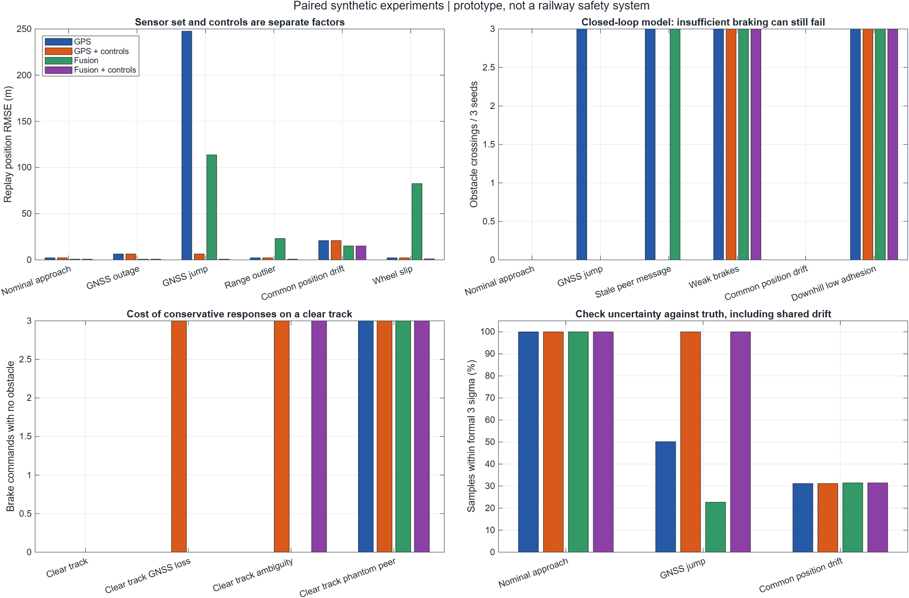
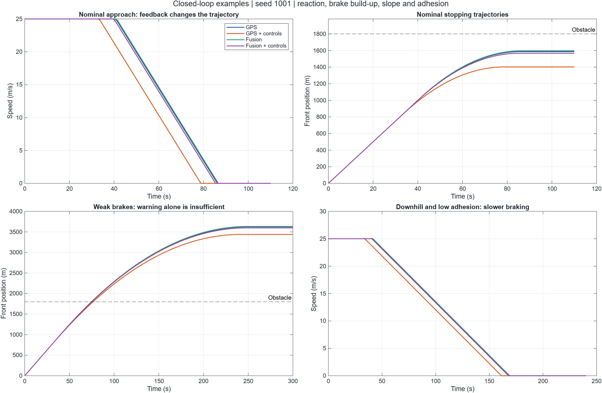
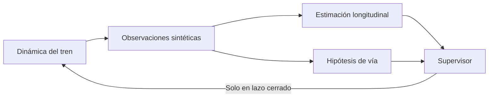
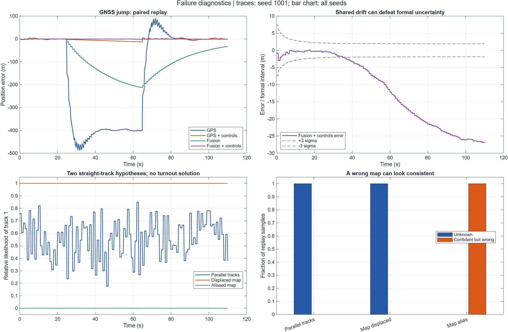

# Localización ferroviaria modular en MATLAB

**¿Qué ocurre cuando los sensores, el mapa o los mensajes dejan de ser fiables?**

Este proyecto educativo compara cuatro configuraciones de estimación y supervisión ante fallos sintéticos. Modela un tren que avanza por una vía recta hacia un obstáculo estacionario, además de trayectos sin obstáculo. Permite separar el efecto de añadir sensores del de activar controles de coherencia y disponibilidad.

**MATLAB base · 17 escenarios · 4 configuraciones · resultados reproducibles**

Es un prototipo de simulación: no implementa LZB ni ETCS, no controla equipos reales y no demuestra fiabilidad ferroviaria ni que pudiera evitar un accidente. Los valores y políticas de frenado son hipótesis del experimento.



## Qué se compara

| Configuración | Sensores longitudinales | Controles adicionales |
|---|---|---|
| GPS | GNSS | No |
| GPS + controls | GNSS | Sí |
| Fusion | GNSS, aceleración, odometría y distancias a tres anclas | No |
| Fusion + controls | Los mismos sensores de fusión | Sí |

Todas las configuraciones incluyen un supervisor de margen de parada. El factor **controles** agrupa rechazo de medidas incoherentes, márgenes con incertidumbre formal, antigüedad de mensajes, disponibilidad de sensores e identidad de vía. Sus componentes individuales no se aíslan en este experimento.

Se evalúan dos modos:

- **Replay:** las cuatro configuraciones reciben las mismas observaciones sobre una trayectoria sin actuación. Se comparan errores de estimación y avisos.
- **Lazo cerrado:** el primer aviso activa una orden hipotética de frenado. La trayectoria cambia según la reacción, aplicación progresiva del freno, adherencia y pendiente.

## Ejecutar

Probado con MATLAB R2026a. No requiere Simulink ni toolboxes adicionales. La interfaz y compatibilidad con otras versiones no se han verificado.

Descarga el repositorio y abre su carpeta en MATLAB:

```matlab
% Comprobación rápida: 17 escenarios, una semilla, sin figuras.
quick = rail_modular_demo(fullfile(pwd,'results_smoke'), 1, ...
    struct('makePlots',false));

% Experimento completo: 30 semillas y exportación de resultados y figuras.
results = rail_modular_demo;

% Sustituir solo el módulo de distancias terrestres.
comparison = compare_sensor_module(results);
```

Cada ejecución incluye las pruebas deterministas de `rail.selftest`. Para ejecutarlas por separado:

```matlab
checks = rail.selftest(rail.default_config());
disp(checks)
```

Desde una terminal abierta en la carpeta del repositorio:

```sh
matlab -batch "results=rail_modular_demo; compare_sensor_module(results);"
```

La ejecución completa contiene **510 combinaciones escenario/semilla**, **2.040 ensayos de arquitectura** y **4.080 simulaciones** al contar replay y lazo cerrado. No son 4.080 situaciones independientes.

## Escenarios

| Grupo | Casos |
|---|---|
| Referencias | Aproximación nominal y trayecto libre |
| Sensores | Pérdida y salto de GNSS, distancia aberrante, pérdida de sensores y deslizamiento de rueda |
| Fallos compartidos | Deriva de posición común a GNSS y distancias |
| Mensajes | Mensaje antiguo y ocupación falsa con mensaje reciente |
| Identidad de vía | Vías paralelas ambiguas, mapa desplazado y mapa coherente pero equivocado |
| Frenado | Frenado insuficiente, pendiente y baja adherencia |
| Falsas alarmas | Trayecto libre con pérdida de GNSS, ambigüedad o falsa ocupación |

Los parámetros exactos se encuentran en [`+rail/scenarios.m`](+rail/scenarios.m) y [`+rail/default_config.m`](+rail/default_config.m).

## Resultados y cómo interpretarlos

Los resultados incluidos corresponden a **3 semillas por escenario**: 51 combinaciones escenario/semilla, 204 ensayos de arquitectura y 408 simulaciones. Son una muestra reproducible para revisar el proyecto, no una estimación de fiabilidad. El experimento por defecto utiliza 30 semillas.

Para regenerar exactamente esta muestra y la comparación modular:

```matlab
results = rail_modular_demo(fullfile(pwd,'results_v2'), 3);
comparison = compare_sensor_module(results);
```

Archivos disponibles:

- [`RESULTADOS.txt`](results_v2/RESULTADOS.txt): lectura de los resultados y los fallos observados.
- [`summary.csv`](results_v2/summary.csv): 68 filas, una por escenario/configuración.
- [`trials.csv`](results_v2/trials.csv): métricas por ensayo.
- [`checks.csv`](results_v2/checks.csv): comprobaciones deterministas superadas.
- [`factor_effects.csv`](results_v2/factor_effects.csv): diferencias entre configuraciones, sin inferencia estadística.
- [`module_comparison.csv`](results_v2_no_ranges/module_comparison.csv): efecto de retirar las distancias para una semilla.
- [`VALIDATION.md`](docs/VALIDATION.md): entorno y alcance de la ejecución verificada.

El RMSE se mide en replay. `ClosedCollisionTrials` cuenta cruces geométricos de la posición del obstáculo; no simula impactos. Las paradas sin obstáculo separan avisos de peligro de respuestas conservadoras por diagnóstico. La cobertura de ±3 sigma es una comprobación empírica del filtro, no un nivel de protección certificado.



## Modularidad



El adaptador `sensorFn` se puede sustituir sin cambiar el estimador ni el supervisor. `compare_sensor_module` retira únicamente las distancias y comprueba que las estimaciones y trayectorias de las configuraciones GPS permanecen exactamente iguales.

| Archivo | Responsabilidad |
|---|---|
| `rail_modular_demo.m` | Experimentos, exportación y comprobaciones globales |
| `+rail/sensor_sample.m` | Generación de observaciones y fallos sintéticos |
| `+rail/estimator_step.m` | Predicción, fusión y rechazo de medidas |
| `+rail/track_step.m` | Dos hipótesis laterales de vía recta |
| `+rail/supervisor_step.m` | Margen de parada y avisos de diagnóstico |
| `+rail/plant_step.m` | Reacción y dinámica de frenado |
| `+rail/selftest.m` | Pruebas de física, fallos y sustitución de módulos |

## Límites que también forman parte del resultado

- La posición longitudinal es unidimensional. El módulo lateral solo compara dos vías rectas; no resuelve curvas, desvíos ni una red ferroviaria.
- El obstáculo está fijo. No se simulan dos trenes con dinámicas independientes.
- Las distancias a anclas son sintéticas; no hay medidas celulares, Wi-Fi, RSSI ni radio real.
- La deriva compartida puede hacer que el filtro subestime su error.
- Un mapa equivocado puede producir una identidad de vía incorrecta con aparente confianza.
- Un aviso no compensa un frenado físicamente insuficiente bajo los supuestos del modelo.
- No hay validación con datos ferroviarios reales, evaluación económica ni certificación de seguridad.



## Documentación ampliada

- [`LEEME.txt`](LEEME.txt): protocolo, unidades, escenarios y definición de métricas.
- [`Propuesta modular`](docs/PROPUESTA_MODULAR.txt): módulos implementados y siguientes experimentos.

Proyecto de aprendizaje de Alejandro Pedersen, desarrollado con apoyo de herramientas de IA. El código y las pruebas permiten revisar qué se ha implementado; las simulaciones no acreditan experiencia de despliegue ferroviario. Se agradecen revisiones de supuestos, casos de fallo y resultados reproducibles.
